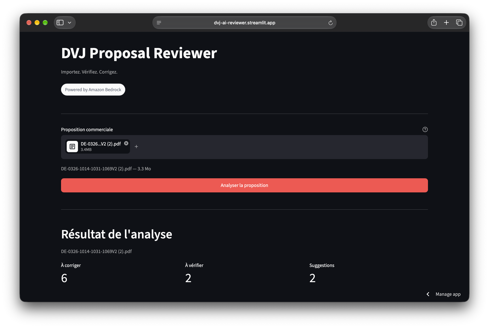
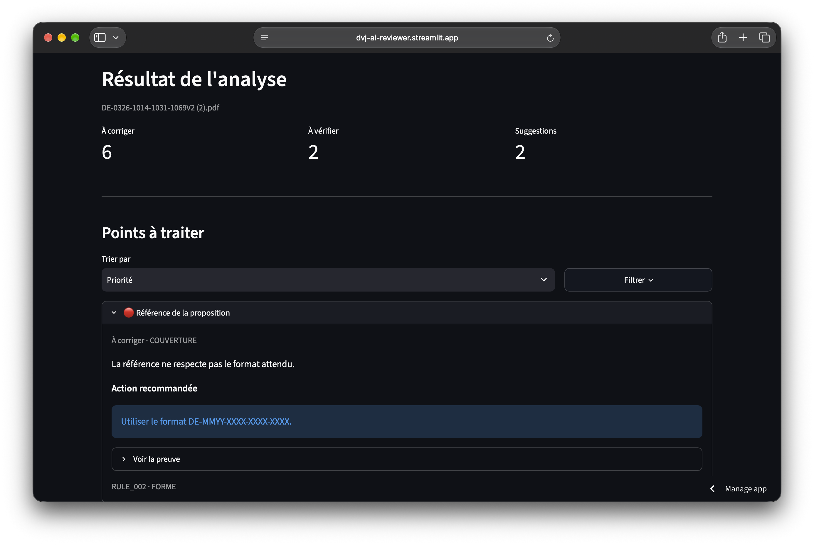
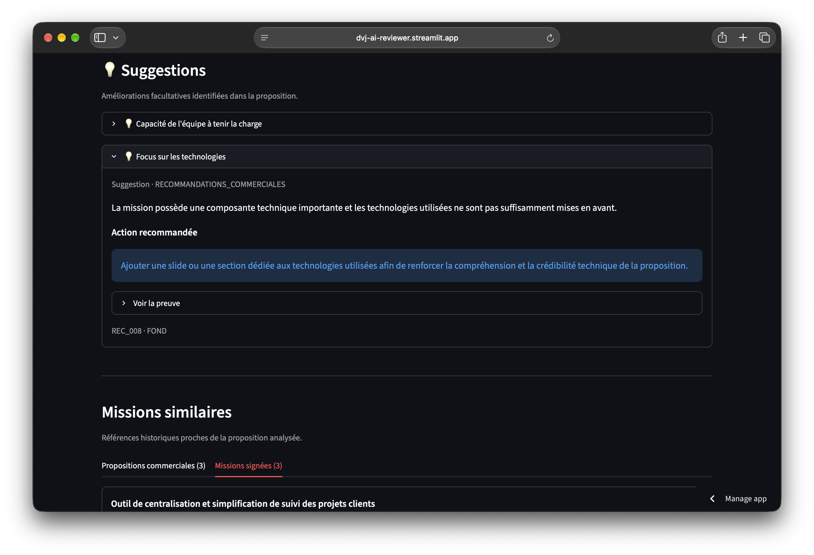

# DVJ Proposal Reviewer

[](https://github.com/BertrandM78/Dvj-ai-reviewer/actions/workflows/ci.yml)

> AI-assisted quality review for commercial proposals, built with Amazon Bedrock.

DVJ Proposal Reviewer is an internal tool designed to automate the first quality review of commercial proposals at DeVinci Junior.

It combines **deterministic checks**, **LLM-based reasoning** and **historical retrieval** to detect issues, explain them and suggest actionable corrections before human validation.



## Impact

- **9 active internal users**
- **58% reduction in first-review time**
- **35 quality controls** evaluated per proposal
- **81.43% accuracy** on the current development/regression benchmark
- **75.86% F1-score** for violation detection

> Evaluation metrics are measured on the development/regression set and are not presented as held-out generalization performance.

---

## Product

The workflow is intentionally simple:

```text
Upload proposal PDF
        ↓
PDF extraction
        ↓
Structured normalization
        ↓
┌─────────────────────────────┐
│       Quality review        │
│                             │
│   Deterministic checks      │
│             +               │
│      LLM-based checks       │
└──────────────┬──────────────┘
               ↓
        Actionable issues
               ↓
      Historical retrieval
               ↓
 Similar proposals / missions
```

For each proposal, the application returns:

- issues that should be corrected,
- controls requiring human verification,
- explanations and supporting evidence,
- recommended corrections,
- relevant historical commercial proposals,
- relevant signed missions.

### Review results



### Suggestions and historical retrieval



---

## Architecture

```text
                         ┌─────────────────────┐
                         │    Streamlit UI     │
                         └──────────┬──────────┘
                                    │
                                    ▼
                         ┌─────────────────────┐
                         │    PDF extraction   │
                         │      PyMuPDF        │
                         └──────────┬──────────┘
                                    │
                                    ▼
                         ┌─────────────────────┐
                         │ Document normalizer │
                         │   Amazon Nova Pro   │
                         └──────────┬──────────┘
                                    │
                         Structured document
                                    │
                    ┌───────────────┴───────────────┐
                    │                               │
                    ▼                               ▼
         ┌─────────────────────┐        ┌─────────────────────┐
         │ Deterministic rules │        │   LLM-based rules   │
         │       Python        │        │   Amazon Nova Pro   │
         └──────────┬──────────┘        └──────────┬──────────┘
                    │                               │
                    └───────────────┬───────────────┘
                                    │
                                    ▼
                         ┌─────────────────────┐
                         │ Result aggregation  │
                         └──────────┬──────────┘
                                    │
                                    ▼
                         Quality review results


Structured document
        │
        ▼
┌──────────────────────────────┐
│ Amazon Bedrock Knowledge Base│
│                              │
│ Commercial proposals         │
│ Signed missions              │
└──────────────┬───────────────┘
               │
               ▼
     Semantic candidates
               │
               ▼
       Nova Pro reranking
               │
               ▼
      Historical references
```

---

## Why not use RAG for everything?

The first prototype stored the quality rules inside an Amazon Bedrock Knowledge Base and relied on semantic retrieval to decide which rules should be evaluated.

That architecture worked for a small demo, but it introduced a fundamental problem:

**Mandatory quality rules are exhaustive, while semantic retrieval is selective.**

In an early experiment, top-k retrieval surfaced only **24 of the 31 mandatory rules** across the tested queries.

A rule that is not retrieved cannot be evaluated.

The architecture was therefore redesigned:

```text
Mandatory quality policy
        ↓
Loaded exhaustively
        ↓
Deterministic + LLM checks

Historical knowledge
        ↓
Semantic retrieval
        ↓
Relevant past proposals / missions
```

RAG is now used only where semantic similarity is actually useful: retrieving comparable historical missions.

This separation became one of the main architectural decisions of the project.

---

## Hybrid review engine

Not every quality control benefits from an LLM.

Rules that can be evaluated reliably with explicit logic are implemented as deterministic Python checks. More contextual controls are evaluated with Amazon Nova Pro.

```text
Rule
 │
 ├── DETERMINISTIC
 │       ↓
 │   Python logic
 │
 └── LLM
         ↓
     Nova Pro
```

The business definition of each rule is stored separately from its execution logic:

```text
config/rules_v2.json    → what must be checked
prompts/                → how the LLM reasons
src/rules/              → execution
app.py                  → presentation only
```

This keeps the business policy auditable and avoids embedding domain knowledge directly inside the UI.

---

## Historical retrieval

The Knowledge Base contains two separate historical corpora:

```text
Commercial proposals
Signed missions
```

The uploaded proposal itself is **never added to the Knowledge Base**.

The pipeline:

```text
Current proposal
      ↓
Structured mission description
      ↓
Bedrock semantic retrieval
      ↓
Top historical candidates
      ↓
Nova Pro reranking
      ↓
0–3 relevant references
```

Retrieval is filtered at the Knowledge Base level by corpus, then reranked according to business similarity:

- client need,
- type of service,
- expected deliverables,
- methodology,
- business context.

Sector similarity alone is intentionally not considered sufficient.

---

## Observability

Each analysis produces a lightweight technical log stored in Amazon S3.

The system records operational metadata such as:

- request ID,
- success / failure,
- processing time,
- latency by pipeline stage,
- Nova Pro token usage,
- estimated model inference cost,
- number of detected issues,
- number of historical references.

The logs intentionally exclude:

- raw PDFs,
- extracted proposal text,
- prompts,
- detailed commercial content.

A small offline analytics script aggregates request volume, success rate, latency, token consumption and model cost.

```bash
python scripts/analyze_logs.py
```

---

## Evaluation

The current development/regression benchmark contains **5 real proposals** and **140 rule decisions**.

### Current results

| Metric | Result |
|---|---:|
| 4-class accuracy | **81.43%** |
| Violation precision | **73.33%** |
| Violation recall | **78.57%** |
| Violation F1 | **75.86%** |
| Errors | **26 / 140** |

### Improvement vs. original V2 baseline

| Metric | Baseline | Current |
|---|---:|---:|
| Accuracy | 72.14% | **81.43%** |
| Precision | 55.88% | **73.33%** |
| Recall | 63.33% | **78.57%** |
| F1 | 59.38% | **75.86%** |

These results are used as a **development/regression benchmark**, not as a claim of held-out generalization performance.

---

## Tech stack

**Application**
- Python
- Streamlit
- PyMuPDF

**AI**
- Amazon Bedrock
- Amazon Nova Pro
- Amazon Bedrock Knowledge Bases

**AWS**
- Amazon S3
- boto3

**Engineering**
- Git / GitHub
- JSON-based rule configuration
- deterministic validation
- structured LLM outputs
- automated evaluation
- request-level observability

---

## Repository structure

```text
.
├── app.py
├── config/
│   ├── rules_v2.json
│   ├── glossary.json
│   └── normalized_document_schema_v2.json
├── images/
│   ├── hero.png
│   ├── review.png
│   └── retrieval.png
├── prompts/
│   ├── normalizer_prompt.txt
│   ├── reviewer_prompt_v2.txt
│   └── historical_rerank_prompt.txt
├── scripts/
│   └── analyze_logs.py
├── src/
│   ├── rules/
│   │   ├── deterministic.py
│   │   ├── llm.py
│   │   ├── aggregator.py
│   │   └── loader.py
│   ├── aws_client.py
│   ├── document_parser.py
│   ├── document_normalizer.py
│   ├── historical_parser.py
│   ├── mission_retriever.py
│   ├── reviewer_v2.py
│   ├── llm_usage.py
│   └── request_logger.py
└── tests/
```

---

## Run locally

### 1. Clone the repository

```bash
git clone <your-repository-url>
cd dvj-ai-reviewer
```

### 2. Create a virtual environment

```bash
python -m venv .venv
```

With `fish`:

```fish
source .venv/bin/activate.fish
```

### 3. Install dependencies

```bash
pip install -r requirements.txt
```

### 4. Configure Streamlit secrets

Create:

```text
.streamlit/secrets.toml
```

Example:

```toml
AWS_ACCESS_KEY_ID = "..."
AWS_SECRET_ACCESS_KEY = "..."
APP_PASSWORD = "..."
LOG_BUCKET = "..."
```

Never commit this file.

The AWS identity used by the application needs permissions for the Bedrock models, the configured Knowledge Base and the S3 logging prefix.

### 5. Run the application

```bash
streamlit run app.py
```

---

## Log analytics

Request logs are stored under:

```text
s3://<log-bucket>/logs/requests/YYYY-MM-DD/<request-id>.json
```

The analytics script reports:

- total requests,
- success rate,
- average / median / P95 latency,
- Nova Pro token consumption,
- estimated model inference cost,
- average latency by pipeline stage,
- review result aggregates,
- failure stage and error type.

The cost estimate covers **Nova Pro inference only** and does not represent the full AWS infrastructure cost.

---

## Privacy and security

The production application processes commercial documents that may contain confidential information.

For that reason:

- uploaded PDFs are processed temporarily and are not persisted,
- uploaded proposals are never inserted into the historical Knowledge Base,
- application secrets are stored outside the repository,
- request logs contain operational metadata rather than proposal content,
- production historical datasets are not included in this public repository,
- raw client PDFs, internal CSV exports and normalized private documents remain outside version control.

The public repository therefore contains the application architecture and code, but not DeVinci Junior's private commercial data.

---

## Limitations

The system is designed as a decision-support tool, not an autonomous approval system.

Some controls intentionally return a human-review status when the available evidence is insufficient.

LLM outputs may vary between executions, which is why deterministic checks are preferred whenever the underlying business rule can be expressed reliably in code.

Historical similarity should be interpreted as supporting context rather than as a recommendation to reproduce a previous proposal.

The current quantitative benchmark is a **development/regression benchmark**. It should not be interpreted as a held-out estimate of generalization performance.

---

## Status

The application is deployed and used internally by DeVinci Junior.

Current focus:

```text
reliability
evaluation
cost and latency monitoring
product usability
```

---

## About this repository

This repository showcases the engineering architecture behind the project while intentionally excluding private commercial data and production datasets.

The goal is not to replace human validation, but to make the first review **faster, more consistent and easier to act on**.
